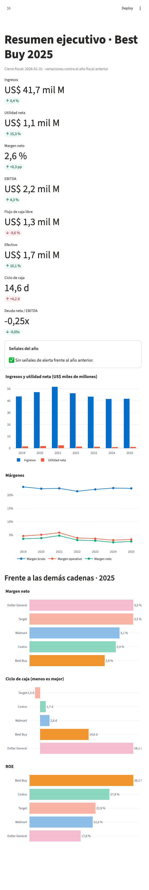
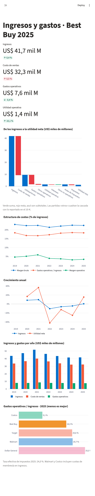
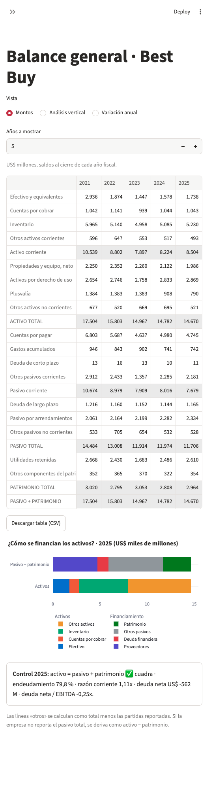

# Salud financiera de cadenas de retail (datos públicos de la SEC)

**Pregunta de negocio:** ¿qué cadena de retail convierte mejor su inventario en caja, y cómo cambió de 2019 a 2025?

## Datos
Estados financieros anuales (10-K) publicados en la SEC de EE. UU. (EDGAR, API `companyfacts`), de libre uso:
Walmart, Target, Costco, Best Buy y Dollar General.

## Herramientas
Python (Pandas) para extraer y limpiar · SQL (DuckDB) para los ratios · Streamlit para la app.

## Estructura
- `scripts/01_extraer_sec.py`: descarga los 10-K → `datos/estados_financieros.csv` (formato largo, con la etiqueta XBRL, el formulario y la fecha de presentación de cada cifra)
- `sql/02_ratios.sql`: arma estado de resultados, balance y flujo de efectivo por empresa-año y calcula márgenes (bruto, operativo, EBITDA, neto), días de inventario, cobro y pago, ciclo de caja, liquidez, endeudamiento, deuda neta/EBITDA, cobertura de intereses, flujo de caja libre, ROE, ROA y crecimiento → `datos/ratios.csv`
- `scripts/02_calcular_ratios.py`: corre el SQL con DuckDB desde Python (no requiere la CLI)
- `app/app.py`: dashboard contable en Streamlit con 8 páginas: resumen ejecutivo, ingresos y gastos, cuentas por cobrar, cuentas por pagar, bancos y flujo de efectivo, estado de resultados, balance general y ciclo de caja comparativo (`app/paginas/`, funciones comunes en `app/comun.py`)

## Cómo correrlo
```bash
pip install -r requirements.txt
cp .env.example .env   # pon tu nombre y correo: la SEC lo exige
python scripts/01_extraer_sec.py
python scripts/02_calcular_ratios.py
streamlit run app/app.py
```
En VS Code: sigue [PASOS_VSCODE.md](PASOS_VSCODE.md) (tareas listas en `Cmd + Shift + P` → Tasks: Run Task).

Las respuestas de la SEC se guardan en `datos/raw/` (caché); usa `--refrescar` para volver a descargar.

## Capturas

### Resumen ejecutivo


### Ingresos y gastos


### Balance general


## Límites
- Cada empresa cierra su año fiscal en un mes distinto (Walmart y Target en enero, Costco en agosto).
  `anio_fiscal` asigna cada ejercicio al año calendario que más cubre: un cierre en enero de 2025 cuenta como 2024.
- Los ratios usan saldos de cierre, no promedios.
- Las etiquetas contables (XBRL) cambian entre empresas y años; el script registra cuál usó en cada cifra.
- Si una cifra se reexpresa en un 10-K posterior, se usa la versión más reciente.
- Walmart y Costco incluyen cuotas de membresía en ingresos, lo que eleva su margen bruto frente a las demás.
- Si una empresa no reporta el total de pasivos (Walmart), se deriva como activo total − patrimonio total.
- Target y Dollar General no reportan cuentas por cobrar (venden casi todo al contado): en el ciclo de caja cuentan como 0 días de cobro.
- Dollar General no presenta una cifra/tag de recompra de acciones en los 10-K de 2023–2025; para esta métrica, el extractor registra 0 y deja vacía la etiqueta XBRL. Es una convención de ausencia, no una cifra publicada por la SEC.

## Conclusiones (10-K 2019–2025)

**Respuesta corta:** Target es la cadena que mejor convierte su inventario en caja (ciclo de **−1,5 días** en 2025), seguida muy de cerca por Costco (1,7) y Walmart (2,8). Dollar General es la más lenta (28,1 días), y Best Buy es la única que empeoró en todo el periodo (de 8,4 a 14,6 días).

| Cadena | Ciclo de caja 2019 | Pico (año) | Ciclo de caja 2025 | Días inventario 2025 | Días pago 2025 |
|---|---:|---:|---:|---:|---:|
| Target | −6,2 | 0,1 (2022) | **−1,5** | 59,5 | 61,0 |
| Costco | 2,9 | 3,7 (2022) | 1,7 | **27,6** | 30,1 |
| Walmart | 2,0 | 7,0 (2022) | 2,8 | 40,1 | 43,0 |
| Best Buy | 8,4 | 14,6 (2025) | 14,6 | 59,1 | 53,6 |
| Dollar General | 34,4 | 46,1 (2023) | 28,1 | 78,0 | 49,9 |

**Hallazgos**
1. **Dos caminos para un ciclo corto.** Costco vende su inventario más rápido que nadie (27,6 días; rotación de 13,2 veces, desde 11,7 en 2019). Target, en cambio, tiene el doble de días de inventario, pero le paga a sus proveedores aún más tarde (61 días): el ciclo negativo lo financia el proveedor.
2. **2020 fue el mejor año para casi todos.** La demanda por la pandemia vació inventarios y alargó los días de pago: Target llegó a −12,2 días y Best Buy a −5,4.
3. **2022 fue el año del exceso de inventario.** Target pasó de −12,2 a 0,1 días y su margen bruto cayó de 29,3 % a 24,6 % (margen neto de 6,6 % a 2,5 %) por las liquidaciones. Walmart subió a 7,0 días con inventario de USD 56,6 mil millones.
4. **Dollar General: el caso de alerta.** Sus días de inventario llegaron a 94,8 en 2022–2023 y su ROE cayó de 39,9 % (2020) a 15,2 % (2024). En 2025 recuperó: 78 días de inventario y ciclo de 28,1 días.
5. **Best Buy pierde apalancamiento con proveedores.** Sus días de inventario casi no cambian (56 → 59), pero sus días de pago bajaron de 69,4 (2020) a 53,6; con ventas que cayeron de USD 51,8 a 41,7 mil millones desde 2021.
6. **Liquidez baja es normal en este modelo.** Walmart (0,79) y Target (0,94) operan con razón corriente menor a 1 porque los proveedores financian el capital de trabajo; no es señal de estrés mientras el ciclo de caja siga cerca de cero.

*Margen bruto de Costco (12,8 %) y Walmart (24,9 %) incluye cuotas de membresía; Dollar General tiene el margen bruto más alto (30,7 %) pero el ciclo más largo.*
